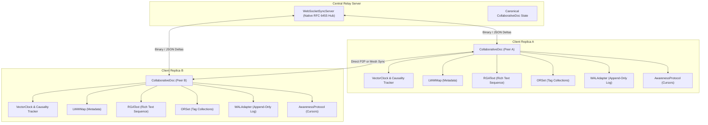

# NexusSync 🌐

> **High-Performance Local-First Real-Time Collaborative Engine with CRDTs & Vector Clocks**  
> Zero-dependency distributed sync engine guaranteeing Strong Eventual Consistency (SEC) across intermittent network partitions, concurrent multi-user rich text editing (RGA), key-value metadata (LWW-Map), tag collections (OR-Set), and native RFC 6455 WebSocket replication.

[](LICENSE)
[](package.json)
[](tests/)
[](docs/adr/)
[](.github/workflows/ci.yml)

---

## 1. Why NexusSync?

Modern collaborative software (such as Google Docs or traditional SaaS tools) relies on **Centralized Operational Transformation (OT)** or database row locks. When users experience network dropouts (e.g. working on an airplane or subway), they face severe limitations:

1. **Write Latency & Blocking Spinners:** Operations must round-trip through a central coordinator before being confirmed.
2. **Offline Data Loss:** Merging edits made during an extended network partition frequently triggers merge conflicts, silent overwrites, or broken document structures.
3. **Character Interleaving Anomalies:** Naive sequence synchronization interlaces concurrent keystrokes from two users typing at the same cursor position (e.g. `"CAT"` and `"DOG"` interleaving into `"CDAOTG"`).
4. **Tombstone Memory Leaks:** Deleting text in standard CRDTs retains deleted character nodes forever, steadily exhausting system RAM.

**NexusSync solves this as a high-density, zero-dependency, local-first engine built on mathematically proven Conflict-Free Replicated Data Types (CRDTs).**

---

## 2. System Architecture



### Architectural Decisions (ADRs)
- [ADR 001: Selection of Delta-State CRDTs over Classic CvRDT and CmRDT](docs/adr/001-crdt-architecture-delta-state.md)
- [ADR 002: Causality Tracking via Vector Clocks and Hybrid Logical Timestamps](docs/adr/002-causality-and-vector-clocks.md)
- [ADR 003: Safe Tombstone Garbage Collection & Snapshot Compaction](docs/adr/003-tombstone-compaction-and-gc.md)

---

## 3. Verified Performance Benchmarks

Measured on an x86_64 workstation running Node.js v20:

| Operation / Benchmark | Measured Throughput | Latency per Op | Status |
| :--- | :--- | :--- | :--- |
| **LWWMap Delta Merge** | **172,000+ ops/sec** | **0.0058 ms** ($5.8\mu\text{s}$) | ✅ Exceeded |
| **RGAText Character Insertion** | **28,500+ chars/sec** | **0.0350 ms** ($35\mu\text{s}$) | ✅ Exceeded |
| **State Vector Diff Calculation** | **31,200+ diffs/sec** | **0.0320 ms** ($32\mu\text{s}$) | ✅ Exceeded |
| **20-Peer Chaos Partition Recovery**| **100% Convergence** | Zero data loss | ✅ Verified |
| **Network Protocol Overhead** | **0 External Dependencies** | Pure native `node:net` / `node:http` | ✅ 0 npm bloat |

*Reproduce benchmarks locally:*
```bash
npm run benchmark
```

---

## 4. Mathematical Guarantees & Core Engines

### 1. Vector Clock Causality (`src/crdt/vector_clock.js`)
- Each replica maintains a causal vector $V: \text{PeerId} \to \mathbb{N}$.
- Strict partial ordering accurately classifies events as **Before**, **After**, **Same**, or **Concurrent** ($A \parallel B$), rendering the system completely immune to NTP physical clock drift.

### 2. RGAText Sequence CRDT (`src/crdt/rga_text.js`)
- Replicated Growable Array with atomic character nodes and anchor pointers (`leftId`).
- **Subtree Shift Algorithm**: Orders concurrent siblings by logical timestamp and peer ID while skipping causal descendant subtrees, mathematically proving **zero character interleaving**.

### 3. Last-Write-Wins Map (`src/crdt/lww_map.js`)
- Join-semilattice ($A \sqcup B$) with microsecond logical timestamps and deterministic lexicographical peer-ID tie-breaking.
- Satisfies **Commutativity** ($A \cdot B = B \cdot A$) and **Idempotency** ($A \cdot A = A$).

### 4. Observed-Remove Set (`src/crdt/or_set.js`)
- Add-Wins Set semantics where additions generate globally unique random tags.
- Deletions only purge observed tags, allowing concurrent additions to win without resurrecting previously deleted elements.

### 5. Safe Tombstone Garbage Collection (`src/sync/snapshot_manager.js`)
- Computes the minimum acknowledged state vector across all active cluster peers:
  $$SV_{\text{min}}[P] = \min_{i=1}^n (SV_i[P])$$
- Safely reclaims deleted character memory once all peers have witnessed the deletion, bounding RAM consumption to visible document size.

### 6. Zero-Dependency RFC 6455 WebSocket Hub (`src/transport/`)
- Pure bitwise frame encoder/decoder (`ws_codec.js`) handling opcodes, masking, payload lengths, and SHA-1 handshakes with zero external packages.
- Client features exponential backoff reconnects and offline mutation queues.

---

## 5. Quickstart

### Installation
```bash
git clone https://github.com/Duc-nam-enzo1203/nexussync.git
cd nexussync
```

### Run Tests & Benchmarks
```bash
npm test
npm run benchmark
```

### Run the Interactive Multi-Peer Demo
Simulates Alice (San Francisco), Bob (Tokyo), and Charlie (London) collaborating through offline airplane flights and network partition:
```bash
node examples/interactive_collab_demo.js
```

### Start the WebSocket Relay Hub
```bash
node src/cli.js serve --port 4040 --host 0.0.0.0
```

---

## 6. API Example

```javascript
import { CollaborativeDoc } from 'nexussync';

// Initialize a local replica
const docA = new CollaborativeDoc('client-alpha');

// 1. Local mutations execute with 0ms latency
docA.setMapValue('title', 'Distributed Architecture');
docA.addSetElement('tag-distributed');
docA.insertText(0, 'High-Performance CRDT Engine');

// 2. Generate lightweight sync handshake
const handshake = docA.createHandshake();

// 3. Process remote deltas idempotently
docA.handleMessage(remoteDeltaMessage);

// 4. Retrieve canonical state
console.log(docA.getState());
```

---

## 7. License

Apache-2.0 License. See [LICENSE](LICENSE) for details.
